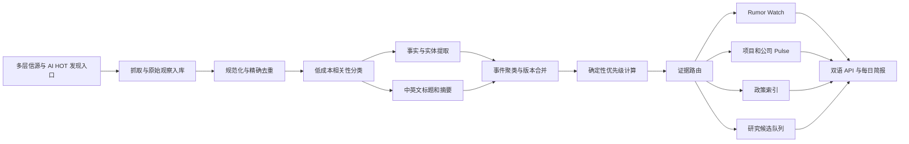

# IDC Atlas 事件数据库与情报精选管线升级计划

> Luna Ultra 实施任务书 / 可直接复制为新任务 Prompt  
> 版本：v1.0  
> 日期：2026-08-08  
> 项目目录：`/Users/xlarge/Desktop/数据中心/data-center-site-work`

## 0. 给执行模型的直接指令

你是 IDC Atlas 的首席数据产品工程师与情报管线架构师。请在现有仓库中完成本任务书的 Gate 0–Gate 3：先审计，再设计数据库和迁移方案，然后实现本地版本与影子运行，最后输出可供另一位 Codex 审阅的完整验收包。

不要只写方案。除非遇到真实阻塞，请持续实现、测试并修复，直到 Gate 3 达标。

本轮不得创建或修改生产 D1，不得切换生产数据源，不得部署到线上。Gate 3 完成后必须停下，将验收包交给用户；只有在用户把结果交回原任务并明确批准后，才可进入 Gate 4 上线。

执行原则：

1. 先阅读仓库内的 `AGENTS.md`、现有文档、数据库配置、Worker、定时任务和测试，再修改代码。
2. 当前工作区可能存在其他未提交改动。必须保留并绕开，不得清理、覆盖、重置或顺手重构。
3. 只改本任务直接需要的文件，优先最小实现，不为未来假设预建复杂框架。
4. 所有公开事实必须保留来源、原始时间、抓取时间和证据状态。
5. 媒体报道只能作为线索或 Rumor Watch 输入，不能因模型评分较高而自动升级为已核验项目、政策结论或经营事实。
6. 模型负责狭窄的语义判断；能用代码稳定完成的去重、权重、阈值、路由、时间和状态转换必须用代码完成。
7. 任何抓取或模型失败都不得静默吞掉，也不得把旧数据包装成新数据。
8. 任何内容为空时，返回真实的空状态或 `verified-no-change`，不得填充虚构更新。

## 1. 项目目标

把 IDC Atlas 从“静态内容文件 + 零散抓取 + 人工补更新”升级为一个有长期记忆、可解释筛选、可回放评估、可双语发布的事件情报系统。

最终系统需要形成以下闭环：



### 1.1 必须实现的结果

- 建立 Atlas 自有 D1 事件数据库，保存来源、观察、事件、实体、事实、评分、路由和发布记录。
- 接入多个高价值信源，而不是依赖少量页面或一次性搜索。
- 对重复转载、同一事件的连续更新和不同语言报道进行聚类。
- 把“证据是否足够”和“内容是否值得读”分成两套独立机制。
- 保留每次评分策略和路由规则的版本，可用历史样本回放。
- 同一个事件只保留一条主记录，同时展示其来源链、后续更新和证据升级过程。
- 生成适合中文和英文站点的结构化输出。
- 每天两轮更新；现有正式快照任务继续独立运行。
- 在抓取失败时保留上一版有效数据，并明确标记当前轮次为 partial、failed 或 blocked。
- 建立一个不依赖人工审核的管理者情报控制台，用于观察管线、解释入选原因、回放策略和安全回滚。

### 1.2 本轮不做

- 不重新设计首页或其他 UI。
- 不启用尚未完成的“产业链信息网”。
- 不开发用户账号、付费订阅或邮件营销。
- 不开发传统 CMS，不要求管理员逐条审批后才能更新网站。
- 不绕过付费墙、登录、robots、版权或网站访问限制。
- 不复制或重新发布媒体全文，只保存合规的元数据、短摘要、事实片段和原文链接。
- 不给出股票涨跌、交易概率或投资建议。
- 不将 AI HOT 的隐藏后端、私有 Prompt 或内部策略视为可复制代码；只借鉴公开方法，并通过 Atlas 自己的规则实现。

## 2. 当前架构审计基线

Gate 0 必须先确认以下现状，若仓库实际情况不同，以代码为准并在报告中解释。

- Worker 当前通过旧版 AI HOT 公共接口获取精选和日报。
- `wrangler.jsonc` 已有 KV 绑定 `IDC_DAILY_SNAPSHOTS`，并有北京时间 06:00 对应的 UTC cron。
- `db/index.ts` 已存在 D1/Drizzle 客户端，预期绑定名为 `DB`。
- `db/schema.ts` 目前没有业务表定义。
- 仓库已有一份早期迁移 SQL，但 Drizzle journal 可能没有对应记录；不得盲目覆盖或重新编号。
- Rumor Watch 与政策索引目前仍含静态数据源或静态 fallback。
- 现有生产 API 合同、`atlas-live-v5` 和首页读取方式必须保持兼容。
- 工作区存在产业链信息网相关未提交文件，本任务不得修改。

Gate 0 交付一份 `docs/event-intelligence/current-state-audit.md`，列出：

- 当前数据入口、定时器、存储、API、静态 fallback 和页面消费关系。
- 当前迁移状态和潜在冲突。
- 工作区中必须保留的无关改动。
- 需要新建、修改和明确不碰的文件清单。
- 阻塞 Gate 1 的问题；没有问题则明确写 `no blocking issue`。

## 3. 从 AI HOT 吸收的方法

本次升级借鉴的是一种“编辑流程产品化”的思路，而不是简单增加 RSS 数量。

### 3.1 信源先于算法

- 建立可维护的信源注册表，而不是在每次任务中临时搜索。
- 每个来源记录层级、主题、地区、抓取方式、独立性分组、最近成功时间和健康状态。
- 优先覆盖官方公告、监管文件、公司 IR、工程博客、能源与电网机构、可信交易数据库和高质量专业媒体。
- 新增来源必须填补明确的覆盖缺口，不能只为了扩大数量。

### 3.2 漏斗而不是一次评分

系统应记录每轮以下数量：

1. 抓取到的原始条目数。
2. 规范化后可评估条目数。
3. 被快速分类为相关的条目数。
4. 进入深度评分的条目数。
5. 聚类后的独立事件数。
6. 进入各公开板块的事件数。
7. 因证据不足、重复或低价值被拒绝的数量与原因。

### 3.3 模型做少量语义工作

- 便宜模型只回答“是否与 Atlas 关注主题实质相关”。
- 强模型只输出结构化维度分、事实候选、实体、研究问题和编辑判断。
- 最终优先级、门槛、主来源选择、证据路由与发布决定由版本化代码完成。
- 模型不确定时进入待处理或保守放行的内部队列，不得直接丢弃潜在高价值官方信息。

### 3.4 策略可回放

- 每次修改分类 Prompt、维度定义、权重或阈值，都需要生成新的策略版本。
- 用固定历史样本回放新旧版本，比较漏报、误报、重复、证据路由错误和成本。
- 没有回放报告的策略变化不得进入生产。

## 4. 信源体系

### 4.1 Atlas 信源等级

沿用并实现以下证据等级，不直接照搬 AI HOT 的三层体系：

| 等级 | 定义 | 典型来源 | 可直接支持的内容 |
| --- | --- | --- | --- |
| T0 | 法定、监管、政府原始文件 | SEC、交易所、政府公报、能源与电网监管机构 | 政策索引、法定披露、已核验事实 |
| T1 | 公司或项目官方一手来源 | IR、新闻稿、电话会、工程博客、项目公告 | 公司动态、项目 Pulse、财报事实 |
| T2 | 高质量原创媒体或专业数据库 | Reuters、Bloomberg、WSJ、FT、行业交易媒体 | Rumor Watch、线索、研究背景 |
| T3 | 行业媒体、采访、二次专业报道 | Data Center Dynamics、Light Reading 等 | Rumor Watch、补充背景 |
| T4 | 机构研究、专家或高质量作者 | 研究机构、资深分析师、技术博客 | 研究线索，不单独确认事实 |
| T5 | 社交平台、论坛、聚合站 | X、Reddit、社区转述 | 发现线索，默认不公开 |
| D | 发现型聚合入口 | AI HOT、新闻聚合 API | 发现和聚类入口，不改变原始来源等级 |

### 4.2 独立性分组

转载同一篇通讯社稿件的十家媒体不算十个独立来源。每条来源需包含 `independence_group`：

- 同一公司官网、IR 和官方社交账号属于同一主体组。
- 同一通讯社的分发稿属于同一报道组。
- 同一稿件的中文翻译、转载和摘要属于同一内容组。
- 只有独立采集或独立确认的报道，才增加独立证据数量。

### 4.3 首批来源范围

Gate 2 只需接入 40–60 个高价值来源，不以 168 个为硬目标。来源应覆盖：

- 美国、中国及重点地区的数据中心政策、能源、电网、审批与环境监管。
- Hyperscaler IR、财报、电话会和工程博客。
- IDC 运营商、REIT、云厂商、GPU、内存、网络、电力、冷却和设备公司的官方来源。
- Reuters、Bloomberg、WSJ、FT、MarketWatch、华尔街见闻等发现型媒体入口；遵守访问边界，仅保存允许获取的元数据和摘要。
- 数据中心、半导体、电力与冷却的专业行业媒体。
- AI HOT v1 作为 AI 行业发现入口，而不是事实确认来源。

每个来源需要配置：

```text
source_id
name
tier
publisher_type
region
topics[]
endpoint_type
endpoint_url
independence_group
language
enabled
poll_interval_minutes
access_notes
copyright_notes
```

### 4.4 来源健康度

必须记录：

- 最后一次尝试和最后一次成功时间。
- HTTP 状态、响应时间、ETag/Last-Modified。
- 连续失败次数和近 7 日成功率。
- 本轮新增条目数、重复条目数、解析失败数。
- 解析器版本和最近异常原因。

不得把“没有新文章”和“抓取失败”混为同一状态。

## 5. D1 数据模型

使用 Drizzle 定义新表，SQLite/D1 时间统一存 UTC ISO 8601；展示时中文站转北京时间，英文站转纽约时间。

### 5.1 核心表

#### `sources`

来源主体与证据等级。

主要字段：`id`、`slug`、`name`、`tier`、`publisher_type`、`region`、`language`、`independence_group`、`enabled`、`created_at`、`updated_at`。

约束：`slug` 唯一；`tier` 使用受控枚举。

#### `source_endpoints`

一个来源可有 RSS、网页、API、IR feed 等多个入口。

主要字段：`id`、`source_id`、`endpoint_type`、`url`、`poll_interval_minutes`、`parser_key`、`access_notes`、`enabled`。

#### `source_sync_state`

保存 ETag、Last-Modified、cursor、最近状态和连续失败数。

约束：每个 endpoint 仅一条当前状态。

#### `ingestion_runs`

每次计划任务或手动影子运行的总记录。

字段包含：`id`、`trigger`、`started_at`、`finished_at`、`status`、`strategy_version`、`fetched_count`、`normalized_count`、`selected_count`、`error_count`、`summary_json`。

#### `observations`

保存每一条原始报道或公告的规范化观察。

字段至少包括：

```text
id
source_id
endpoint_id
canonical_url
original_url
external_id
title_original
summary_original
language
author
published_at
discovered_at
fetched_at
content_hash
canonical_url_hash
raw_payload_json
access_status
```

约束与索引：

- `canonical_url_hash` 唯一或受控冲突处理。
- `source_id + external_id` 在 external_id 存在时唯一。
- 索引 `published_at`、`source_id`、`content_hash`。

#### `observation_analysis`

保存模型输出，和原始观察分离。

字段：`observation_id`、`classifier_version`、`topic_bucket`、`is_relevant`、`uncertain`、五维评分、`editor_judgment`、`reason`、`entities_json`、`facts_json`、`translated_title_zh`、`translated_title_en`、`summary_zh`、`summary_en`、`embedding_model`、`embedding_ref`、`analyzed_at`。

#### `entities`

公司、项目、园区、地点、产品、政策机构、技术和人物的规范实体。

字段：`id`、`entity_type`、`canonical_name`、`name_zh`、`name_en`、`ticker`、`country`、`aliases_json`。

#### `events`

聚类后的独立事件，是前台和简报的核心对象。

字段至少包括：

```text
id
event_key
event_type
title_zh
title_en
summary_zh
summary_en
first_seen_at
last_updated_at
event_time
region
evidence_status
publication_state
main_observation_id
strategy_version
internal_priority
```

#### `event_observations`

事件与报道的多对多关系。

字段：`event_id`、`observation_id`、`relationship`、`is_independent_confirmation`、`is_main`、`added_at`。

`relationship` 受控值建议为：`origin`、`confirmation`、`official_response`、`syndication`、`translation`、`follow_up`、`contradiction`。

#### `event_entities`

事件和实体的关系，包含角色：主体、客户、供应商、交易对手、项目、地点、监管机构等。

#### `event_facts`

结构化事实和边界。

字段：`event_id`、`fact_type`、`value_text`、`value_number`、`unit`、`qualifier`、`period_start`、`period_end`、`source_observation_id`、`confidence_state`。

#### `event_updates`

记录同一事件从传闻、回应、签约、审批、建设到投运的状态变化，禁止覆盖历史。

#### `selection_decisions`

保存 eligibility、priority、route 和拒绝原因。

字段：`event_id`、`strategy_version`、`eligible`、`priority_score`、`route`、`reason_codes_json`、`decided_at`。

#### `scoring_versions`

保存代码版本、Prompt 版本、权重、阈值、发布时间和回放报告引用。

#### `publication_records`

记录事件何时进入哪个语言、页面、API 版本或日报，支持幂等与回滚。

#### `pipeline_stage_runs`

记录每个条目在各阶段的耗时、模型、token、成本、重试、失败原因。

#### `admin_audit_logs`

记录管理员在控制台触发的重跑、暂停来源、策略切换、事件拆分、事件合并和回滚。任何管理操作必须保存操作者、时间、操作前后状态、原因和关联 run/event/source，不能只改最终结果。

### 5.2 迁移规则

- 先审计现有迁移 SQL、Drizzle journal 和生产绑定，不得直接运行 `db:generate` 覆盖历史。
- 新迁移使用下一个未冲突编号，并提交纯 SQL 与 Drizzle schema。
- 迁移必须可以在空白本地 D1 和现有结构快照上各跑一次。
- 建立迁移前后 schema 对比和回滚说明。
- Gate 3 前只允许本地数据库或专用临时影子数据库。

## 6. 处理流水线

### Stage 0：抓取与原始归档

- 每个 connector 只负责调用一个明确入口并返回统一 observation envelope。
- 使用 ETag、Last-Modified、cursor 和条件请求减少重复流量。
- 原始 payload 可裁剪保存，但必须足以审计解析结果。
- 抓取失败记录错误，绝不生成空白“新内容”。

### Stage 1：规范化和精确去重

- 规范 URL，移除已知追踪参数，但保留原始 URL。
- 标题做 Unicode、空白和常见站点后缀规范化。
- 计算 canonical URL hash、content hash 和 source external ID。
- 先做完全一致、转载标识和已知通讯社分发去重。

### Stage 2：快速相关性分类

分类器只输出五类之一：

1. Atlas 核心基础设施：IDC、云资本支出、电力、冷却、网络、GPU、内存、项目和交易。
2. 上游硬件与计算需求：芯片、服务器、模型需求、供应链。
3. 对 Atlas 研究有实质影响的政策、资本市场或企业事件。
4. 仅出现关键词，没有实际基础设施含义。
5. 无关。

前三类进入后续阶段，后两类停止。若分类器明确标记 `uncertain=true`，默认进入内部待处理，避免漏掉高价值一手来源。

优先使用正文或原始摘要，不能只看标题。

### Stage 3：并行语义处理

对相关观察并行执行：

- 强模型五维评分。
- 实体和事实提取。
- 中英文标题、摘要和关键词生成。
- 必要时生成 embedding。

模型不得输出最终总分，不得决定公开路由，不得把媒体报道标成已核验事实。

五个评分维度：

1. 主题相关度。
2. 基础设施传导机制深度。
3. 信息具体性与可量化程度。
4. 对研究问题的增量价值。
5. 对目标读者的阅读价值。

输出必须符合 JSON Schema；解析失败时记录 pending，不能丢弃原记录。

### Stage 4：资格门槛

在最终优先级之前先做确定性门槛：

- 来源是否允许进入该 route。
- 是否有原文链接与发布时间。
- 是否与已有事件完全重复。
- 是否只有无来源的结论或交易判断。
- 政策是否来自政府、监管或法定文件。
- 项目容量是否具有明确状态和单位。

资格判断与优先级分开存储。高热度不能绕过证据门槛。

### Stage 5：事件聚类

聚类顺序必须是：

1. external ID、canonical URL、content hash。
2. 独立性分组和转载关系。
3. 实体、行动、对手方/项目、地点、时间窗的确定性键。
4. 最后才使用 embedding 相似度辅助。

建议事件键：

```text
primary_entity | action | counterparty_or_project | location | reporting_period
```

严禁错误合并：

- 规划容量、潜在容量、已签约容量、获批容量、在建容量、投运容量和收入贡献容量。
- 园区总电力与 IT 负载。
- 融资传闻、融资完成和资本开支预算。
- 项目选址、土地收购、并网、开工、设备到货和投运。
- 市场传闻、公司回应、官方公告和法定披露。

### Stage 6：确定性优先级与主来源

内部优先级由版本化代码计算，示意结构：

```text
priority =
  semantic_dimension_weights
  + source_tier_weight
  + specificity_weight
  + independent_confirmation_weight
  + recency_weight
  + topic_priority_weight
  - syndication_penalty
  - ambiguity_penalty
```

不要照抄其他项目阈值。先用 Atlas 历史样本校准，再确定各类别和来源等级的阈值。

主来源选择规则：

- 若官方一手来源直接确认事实，官方文件作为主证据。
- 若事件来自媒体独家且官方尚未确认，原创媒体保留为 claim source，不得伪装成官方事实。
- 公司“不予置评”或否认是独立的 `official_response`，不能覆盖原始报道。
- 转载和翻译不得取代原创报道。
- 后续法定披露可升级 evidence status，但历史版本必须保留。

### Stage 7：证据路由

| Route | 最低证据要求 | 说明 |
| --- | --- | --- |
| Rumor Watch | T2/T3 原创报道或可追溯线索 | 明确写“据报道/消息人士称”，保留访问限制，不判断真伪概率 |
| 项目与公司 Pulse | T0/T1 一手确认 | 需要明确事件、日期、主体和状态 |
| 政策索引 | T0 官方文件 | 输出简要政策变化、适用范围、生效时间和对产业的直接影响，不只返回原文入口 |
| 研究候选 | 至少一个可信来源和清晰研究问题 | 进入编辑研究队列，不自动生成结论 |

证据状态建议：

```text
lead
reported
official_response
officially_confirmed
legally_disclosed
superseded
retracted
verified_no_change
```

### Stage 8：入库、API 和日报

- 全流程幂等，同一 observation、event 和 publication 不重复创建。
- API 先从 D1 读取；出现数据库故障时可回退当前静态数据，但响应中必须包含 freshness 和 fallback 状态。
- 每个公开事件返回主来源、其他来源数、事件时间、更新时间、证据状态、事实边界和双语内容。

## 7. 容量与财务事实的强制边界

所有容量事实必须携带 qualifier：

```text
proposed
potential
land_secured
power_secured
contracted
permitted
under_construction
commissioned
operating
revenue_generating
```

所有容量还必须区分：

```text
total_power
utility_power
it_capacity
gpu_nameplate_compute
leased_capacity
```

不得把：

- 远期规划写成已建成。
- 园区供电写成 IT 容量。
- 芯片铭牌算力写成数据中心负载。
- PP&E 总额全部归因于 AI。
- 公司口径、媒体估算和 Atlas 推断混成同一事实。

所有 Atlas 推断必须明确标记 `inference`，并附推断所用事实。

## 8. AI HOT v1 Connector

AI HOT 在 Atlas 中定位为发现层 D，不是事实数据库。

实现要求：

- 以 AI HOT 当前公开 v1 文档和已安装 `aihot` Skill 为准，不猜测 endpoint、字段或 ID。
- 支持精选条目、热点事件、日报和必要的增量变化接口；具体只接公开且稳定的能力。
- 默认拉取最近 24 小时精选；无精选时按官方文档规定的 fallback 查询，不自行扩展为未授权抓取。
- 使用 ETag 和增量 cursor，保存 `published_at` 与 `discovered_at`。
- AI HOT 的推荐理由、聚类和翻译可以作为辅助字段，但 Atlas 必须重新应用自己的来源等级、证据门槛和事件聚类规则。
- 每条内容保留 `curated_from = AI HOT` 和原始来源链接。
- API 网络失败时标记 `fetch_failed`，不得用训练记忆或旧日报冒充当前结果。

建议文件：

```text
worker/connectors/aihot-v1.ts
worker/connectors/types.ts
worker/connectors/registry.ts
```

## 9. 其他 Connector 设计

首版至少支持：

- RSS/Atom。
- 结构化 JSON API。
- 官方公告列表页的合规 HTML 元数据抓取。
- SEC/交易所/政府公告入口。
- 手动提交的原文 URL，用于补录但仍经过同一管线。

每个 connector 必须：

- 输出统一 observation envelope。
- 有 fixture 和解析测试。
- 有明确 User-Agent、超时和有限重试。
- 尊重 robots、访问限制和版权边界。
- 不在失败时改写上一版成功的 sync cursor。

## 10. 定时任务

建议北京时间：

- 05:30：夜间事件抓取、聚类和路由。
- 06:00：保留现有正式数据快照任务。
- 17:30：日间事件抓取、聚类和路由。

Worker 的 scheduled controller 必须根据 cron 或触发参数区分任务，不能所有 cron 都执行同一函数。

所有数据库时间存 UTC；中文状态栏展示北京时间，英文状态栏展示纽约当地时间并正确处理夏令时。

## 11. 每日简报

每日简报从已处理的事件数据库确定性生成，不再调用模型重新写新闻。

生成规则：

- 每个事件只出现一次。
- 按项目、公司/财报、算力硬件、电力与冷却、政策、交易/传闻分组。
- 组内按内部优先级和事件时间排序。
- 同时输出中文和英文，但英文版可降低仅影响中国本地市场的事件权重。
- 每条包含标题、一句话事实、为何重要、证据状态、主来源和原文链接。
- 没有合格事件时显示“本轮无新增合格事件”，不得补旧内容充数。

## 12. 评估与回放

### 12.1 固定评估集

从 Atlas 历史数据构建 200–500 条 fixture，至少覆盖：

- 真正重要的一手项目、财报、政策和并购。
- 媒体独家 Rumor。
- 大量重复转载。
- 只有 AI 关键词但与基础设施无关的新闻。
- 容量状态容易混淆的样本。
- 中英文同一事件。
- 后续官方确认或否认的事件。

Fixture 必须包含期望的：相关性、事件簇、主来源、证据状态、route、容量 qualifier 和是否公开。

### 12.2 指标

每个策略版本输出：

- 相关条目 precision / recall。
- 高价值事件召回率。
- 重复事件率和错误合并率。
- 主来源选择准确率。
- Rumor 错升 Pulse 的数量，目标必须为 0。
- 非官方内容进入政策索引的数量，目标必须为 0。
- 容量状态错误率，目标必须为 0。
- 双语字段完整率。
- 单条平均模型成本、总运行成本和 P95 延迟。
- 各来源等级和主题的入选分布。

### 12.3 策略升级规则

- 新策略必须和当前基线在同一 fixture 上对比。
- 若高价值召回、route 安全或容量准确性退化，阻止发布。
- 允许优先级分布变化，但必须解释原因。
- 每份回放结果保存策略版本、代码 commit、Prompt hash 和模型名。

## 13. 可观测性

首版不需要开发完整后台，但必须生成内部 JSON 和简洁 HTML 报告，至少展示：

- 来源总数、启用数、近 30 分钟成功数、异常数。
- 本轮抓取、可评估、相关、深度评分、事件簇、公开数量漏斗。
- 各阶段失败数和 P50/P95 时长。
- 模型调用数、token、估算成本和失败率。
- 各 route、主题和来源层级的分布。
- 最近失败来源与错误原因。
- 当前策略版本与上次回放结果。
- 选中事件的完整来源链和主来源理由。

建议输出：

```text
artifacts/event-intelligence/latest-run.json
artifacts/event-intelligence/latest-run.html
artifacts/event-intelligence/strategy-comparison.json
```

### 13.1 管理者情报控制台

需要开发管理者后台，但它的定位是“Atlas Intelligence Control Room”，不是内容编辑 CMS。日常更新仍由自动管线完成，后台用于观察、解释、测试和恢复。

#### Gate 2：本地只读版

Gate 2 必须提供一个本地可访问、默认不进入公开导航的只读控制台，建议路由为 `/admin/intelligence`。至少包含六个页面或视图：

1. **Overview**：最近两轮运行状态、来源健康、漏斗、公开事件数、失败数、成本和 freshness。
2. **Sources**：来源等级、入口、独立性分组、最近成功、失败率、抓取数量和解析异常。
3. **Event Stream**：聚类后的事件列表，可按 route、地区、主题、证据状态、来源等级和时间筛选。
4. **Event Detail**：主来源、全部关联报道、聚类理由、实体、事实、容量边界、状态变化、评分和 route reason codes。
5. **Pipeline Runs**：每个阶段的数量、时长、失败、模型调用、token 和成本；可展开到单条 observation。
6. **Strategy Lab**：当前策略版本、历史 fixture 回放、新旧分布、错误案例和回归结果。

本地只读版直接读取本地或影子 D1，不需要创建新的远程账户、正式访问控制或生产 secret。

#### Gate 4：受保护操作版

只有用户批准上线后，才增加以下受控操作：

- 手动重跑某个失败 endpoint、observation 或 pipeline run。
- 暂停或恢复异常来源。
- 重新计算指定事件的聚类、评分或路由。
- 对明显错误聚类执行拆分或合并，并记录原因。
- 切换经过回放验证的策略版本。
- 将某个 route 回滚到上一有效快照。

这些操作不是每日内容审批。系统必须在无人操作时仍能完成两次日更；控制台只提供运营干预和事故恢复能力。

#### 安全边界

- `/admin/*` 永远不能被搜索引擎索引，也不能进入 sitemap。
- 正式版必须使用现有身份系统或 Cloudflare Access 等受控访问方式；选择和配置第三方访问控制属于 Gate 4 的外部状态变更，必须先说明账号、权限、cookie/隐私、费用和回滚方式，并取得用户批准。
- 不允许把抓取凭证、API token、完整付费媒体正文或内部 Prompt 输出到浏览器。
- 浏览器只调用专用管理 API；所有写操作需要身份校验、CSRF 防护、限流和 `admin_audit_logs`。
- 管理 API 与公开 API 分开，不能通过猜测 URL 获得内部来源和运行详情。
- 控制台发生故障不得影响公开站点和定时更新。

#### 管理后台视觉原则

- 复用 IDC Atlas 现有设计 token、字体、间距和中英文导航行为。
- 信息密度可高于公开站，但保持表格可读、状态颜色有文字标签、桌面和移动端不发生横向内容截断。
- 优先提供来源链、状态和原因，不使用没有解释的单一“AI 分数”。
- 不模仿门户网站，也不把后台做成炫技大屏；它是高密度、可追溯的产业情报工作台。

## 14. 与现有站点的兼容

- 保持现有 `atlas-live-v5` API 字段和页面读取方式可用。
- 新 API 可以增加字段，但不得删除现有字段或改变其语义。
- 先写 adapter 把 D1 event 转成现有前端需要的结构。
- 静态 `RUMOR_BRIEFS`、`POLICY_BRIEFS` 等在过渡期保留为 fallback。
- 按 Rumor → Policy → Pulse → Research Queue 的顺序逐路由切换，不做一次性大爆炸迁移。
- 不修改尚未上线的产业链信息网数据和路由。

## 15. 建议文件结构

最终结构可根据仓库现状微调，但不要创建不必要抽象：

```text
db/
  schema.ts
drizzle/
  0002_event_intelligence.sql
worker/
  connectors/
    types.ts
    registry.ts
    aihot-v1.ts
    rss.ts
    json-api.ts
  event-intelligence/
    normalize.ts
    classify.ts
    analyze.ts
    cluster.ts
    facts.ts
    score.ts
    route.ts
    publish.ts
    run.ts
app/
  admin/intelligence/
    page.tsx
    sources/
    events/
    runs/
    strategy/
scripts/
  backfill-event-intelligence.ts
  run-event-intelligence-shadow.ts
  evaluate-event-strategy.ts
  render-event-run-report.ts
  fixtures/event-intelligence/
docs/event-intelligence/
  current-state-audit.md
  schema-and-migration.md
  source-registry.md
  scoring-and-routing.md
  shadow-run-report.md
```

若现有代码风格更适合更少文件，可以合并，但每个阶段仍需可以单独测试和观测。

## 16. 必须覆盖的测试

### 数据和迁移

- 空白数据库迁移成功。
- 现有结构快照升级成功。
- 重复执行迁移不破坏数据。
- Drizzle schema 与实际 D1 schema 一致。

### 抓取与幂等

- 同一条目重复抓取不新增 observation。
- 相同转载可以关联但不增加独立证据数。
- 失败不会推进 cursor 或覆盖最后成功时间。
- ETag 304 不生成新条目。

### 分类与路由

- 关键词型无关新闻不进入深度处理。
- 模型不确定时保守进入内部待处理。
- T2/T3 媒体独家只能进入 Rumor Watch。
- 非 T0 内容不能进入政策索引。
- 官方确认可把事件从 reported 升级为 officially_confirmed，同时保留历史。

### 聚类

- 中英文同一公告合并。
- 通讯社转载合并。
- 同一公司不同园区不合并。
- 同一园区不同建设阶段不错误覆盖。
- 传闻和官方回应属于同一事件但保留不同 relationship。

### 事实边界

- proposed 不变成 operating。
- total power 不变成 IT capacity。
- PP&E 总额不自动写成 AI CAPEX。
- 金额、容量、日期、币种与单位保留来源。

### 时间与任务

- UTC 存储、北京时间和纽约时间显示正确。
- 夏令时边界测试通过。
- 三个 cron 调用不同任务。
- 每日简报在相同数据上输出稳定。

### API 回归

- 现有正式 API contract 测试通过。
- D1 route 和静态 fallback 的返回结构一致。
- 空数据、旧数据和 partial run 都有明确 freshness 状态。

## 17. 实施阶段与停线门

### Gate 0：只读审计

完成当前架构、迁移、工作区、数据流和 API 合同审计。

通过标准：审计文档完整，没有对代码和生产环境造成修改。

### Gate 1：Schema 与迁移评审

完成 Drizzle schema、迁移 SQL、来源注册结构、事件模型、路由规则和回滚设计。

通过标准：

- 可在空白本地 D1 运行。
- 可解释现有迁移/journal 冲突如何处理。
- 没有删除或覆盖已有表。
- Schema review 报告列出所有索引、唯一约束和数据保留策略。

若无法证明迁移安全，停止并报告，不进入 Gate 2。

### Gate 2：本地实现

完成：

- D1 schema 和本地迁移。
- AI HOT v1 与首批 connector。
- 规范化、分类、聚类、评分、路由和双语输出。
- 影子运行脚本、评估脚本和可观测报告。
- 本地只读管理者情报控制台。
- 单元、集成和 API contract 测试。

通过标准：所有新增测试与现有测试、lint、build 通过；失败项必须修复或明确说明为已有且与本任务无关。

### Gate 3：真实影子运行

用真实公开来源运行至少一个完整双时段影子周期，不改生产页面。

影子报告必须包含：

- 来源健康度。
- 漏斗数据。
- 事件簇示例及来源链。
- 评分和 route 原因。
- 与现有静态输出的差异。
- 误报、漏报、重复、错误聚类和容量边界检查。
- 模型调用和成本估算。
- 失败与未解决风险。

Gate 3 完成后立即停止。不要部署。把第 19 节验收包交给用户，让用户回到原 Codex 任务进行审阅。

### Gate 4：生产上线，仅在再次批准后

未来批准后才可执行：

1. 创建或绑定正式 D1。
2. 对正式数据库做备份和迁移。
3. 先切 Rumor route，观察后再切其他 route。
4. 对同一已测试 commit 构建、保存 Sites 项目并部署。
5. 验证 Cloudflare Worker、正式 API、中文站、英文站和实际 production URL。
6. 执行 cache-bust 读回并保存证据。

## 18. 回滚设计

- 每个 route 有独立 feature flag。
- D1 读取失败或质量门不通过时，可单独回退静态 fallback。
- 不删除旧静态数据，直到新管线稳定运行至少 14 天。
- 迁移前保留数据库备份或导出。
- 发布记录保存 API 版本和事件版本，允许恢复上一个有效快照。
- 回滚不得删除已经采集的原始观察和审计记录。

## 19. Luna Ultra 最终验收包

完成 Gate 3 后，请一次性提交：

1. 完成内容摘要，按 Gate 列出。
2. `git status --short` 和本任务相关 diff 统计。
3. 所有新增与修改文件列表，说明每个文件用途。
4. Schema 图、迁移 SQL 和迁移验证结果。
5. 来源注册表及健康报告。
6. 处理漏斗和影子运行报告。
7. 至少 10 个事件簇样例：主来源、其他来源、事件状态和 route 理由。
8. 评分策略版本、Prompt hash、模型与成本。
9. 历史 fixture 回放的新旧对比。
10. 测试、lint、build 的完整结论。
11. 未解决风险、已知限制和上线前需要用户决定的事项。
12. 明确声明：是否修改了生产 D1、生产 Worker、正式站点或产业链信息网。Gate 3 的正确答案应为“没有”。
13. 管理者控制台截图或录屏，覆盖 Overview、Sources、Event Detail、Pipeline Runs 和 Strategy Lab。

## 20. 完成标准

只有同时满足以下条件，才可说 Gate 3 完成：

- 事件、来源、证据状态和事实边界可以在数据库中追溯。
- 同一事件的重复报道被正确聚类，主来源选择可解释。
- 媒体 Rumor 不会因评分高而进入已核验板块。
- 政策只由官方来源建立，并给出简要变化、适用范围和影响。
- 容量、财务和时间口径没有混淆。
- 中文与英文输出字段完整，时区正确。
- 抓取失败、模型失败和无新增内容都有真实状态。
- 策略变化可以通过固定样本回放。
- 现有 API contract、前端和正式快照逻辑未被破坏。
- 本地管理者控制台能够解释来源、事件簇、评分、路由和运行失败，同时不成为日常更新的人工审批瓶颈。
- 没有修改或上线产业链信息网。
- 没有生产部署或不可逆外部操作。

## 21. 给审阅者的重点

后续 Codex 审阅时优先检查：

1. 模型是否被授予了不应拥有的最终发布权。
2. evidence status 与 priority 是否真正分离。
3. 独立性分组是否阻止转载被当作多方确认。
4. 事件聚类是否会吞掉不同园区、阶段或容量口径。
5. 迁移与现有 Drizzle journal 是否一致。
6. 定时任务是否区分抓取与正式快照。
7. 失败时是否保留上一版有效数据并暴露 freshness。
8. AI HOT 是否只作为发现入口，并保留原始来源。
9. 影子运行是否使用真实公开数据，而不是只跑 fixture。
10. Gate 3 是否真的停在本地/影子环境，没有提前部署。
