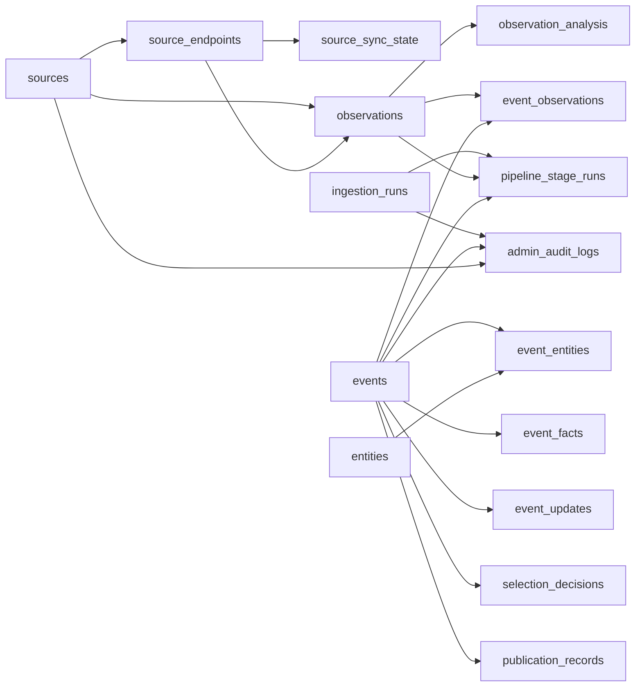

# 事件数据库 Schema 与迁移评审

评审日期：2026-08-08 Asia/Shanghai  
Schema：`db/schema.ts`  
迁移：`drizzle/0000_event_intelligence.sql`

## 1. 迁移选择

审计确认 `drizzle/meta/_journal.json` 原本为空、仓库没有现有迁移 SQL，也没有业务表。因此没有按任务书中的假定使用 `0002`，而是用 Drizzle 生成第一个迁移并将文件固定命名为 `0000_event_intelligence.sql`。这不会删除、覆盖或重编号既有表；当前不存在既有表。

本迁移只描述 SQLite/D1 结构，没有 `database_id`、远程 D1、Sites 资源或生产执行步骤。Gate 3 前的执行器只允许把它应用到本地 shadow SQLite/D1 兼容数据库。

## 2. 关系图

## 3. 表与约束

| 表 | 作用 | 关键唯一性/约束 | 高频索引 |
| --- | --- | --- | --- |
| `sources` | 来源主体、证据等级、独立性组和健康摘要 | `slug` 唯一；`tier` 受控为 T0–T5/D | tier + enabled、last success + failures |
| `source_endpoints` | 一个来源的 RSS/API/HTML/AI HOT 等入口 | `(source_id, url)` 唯一 | enabled + poll interval |
| `source_sync_state` | ETag、Last-Modified、cursor 和失败状态 | `endpoint_id` 主键，保证每 endpoint 一条状态 | 主键查找 |
| `ingestion_runs` | 每轮触发、漏斗计数、策略版本和总状态 | `status` 为 running/succeeded/partial/failed/blocked | 由 stage 表反查 |
| `observations` | 原始观察的规范化元数据和裁剪 payload | `canonical_url_hash` 唯一；`(source_id, external_id)` 唯一（NULL 可重复） | published、source、content hash |
| `observation_analysis` | 与原始观察分离的分类、分析、双语和事实候选 | `observation_id` 主键；失败可留 `analysis_status=pending/failed` | 通过 observation 主键 |
| `entities` | 公司、项目、地点、产品、机构等规范实体 | `canonical_name` 唯一 | type + name |
| `events` | 聚类后的主事件和当前证据/发布状态 | `event_key` 唯一；优先级与 evidence status 分开 | status + priority、last updated |
| `event_observations` | 事件与观察的多对多来源链 | `(event_id, observation_id)` 主键；relationship 保留转载/回应/矛盾等 | observation、relationship |
| `event_entities` | 事件实体及角色 | `(event_id, entity_id, role)` 主键 | entity |
| `event_facts` | 带来源的金额、容量、日期和 qualifier | 每条事实保留 `source_observation_id`、`confidence_state` | event + fact type、source |
| `event_updates` | 传闻→回应→签约→审批→建设→投运的不可覆盖历史 | 每次状态变化新行 | event + observed time |
| `selection_decisions` | 资格、优先级、路由和 reason codes | `(event_id, strategy_version)` 唯一 | route + priority |
| `scoring_versions` | 权重、阈值、代码/Prompt hash 和回放引用 | `version` 主键 | 由版本主键查找 |
| `publication_records` | 双语 route/target 的幂等发布和回滚关系 | `(event_id, language, target)` 唯一 | target + published time |
| `pipeline_stage_runs` | 每个 stage 的耗时、模型、token、成本和失败 | 关联 run、observation、event；不覆盖失败记录 | run + stage、observation、event |
| `admin_audit_logs` | 受控后台操作的前后状态 | 关联 actor/reason 和 run/event/source | created time、target 组合 |

所有时间字段使用 UTC ISO 8601 字符串；`summary_json`、`raw_payload_json` 等 JSON 文本只保存可审计的短内容，不保存付费媒体全文或凭证。

## 4. 事实边界

`event_facts.qualifier` 和 `unit` 是硬边界字段，首版允许的容量状态包括 `proposed`、`potential`、`land_secured`、`power_secured`、`contracted`、`permitted`、`under_construction`、`commissioned`、`operating`、`revenue_generating`；容量口径区分 `total_power`、`utility_power`、`it_capacity`、`gpu_nameplate_compute`、`leased_capacity`。模型候选若缺失状态或单位，不得由 adapter 自动补成已投运事实。

`events.evidence_status` 不承载“值得阅读”的分数；`events.internal_priority` 与 `selection_decisions.priority_score` 只表达确定性排序。媒体高分不能越过 T0/T1 的 route 门槛。

## 5. 本地迁移验证方案

1. 对空白 SQLite/D1 兼容库执行 `0000_event_intelligence.sql`。
2. 对现有结构快照执行同一迁移；审计基线的结构快照为空，因此结果应与空白库相同。
3. 重复执行时先由迁移执行器读取本地 migration ledger，跳过已应用版本；不会把 SQL 改成 `IF NOT EXISTS` 并掩盖结构漂移。
4. 读取 `sqlite_schema`、`PRAGMA foreign_key_list`、`PRAGMA index_list` 与 Drizzle snapshot，对 17 张表、全部唯一索引和业务查询索引做比对。
5. 用代表性查询执行 `EXPLAIN QUERY PLAN`；来源健康、事件 route、观察发布时间和事件来源链必须使用对应索引。

## 6. 保留与回滚

- 原始观察、来源健康和管理员审计记录不因事件合并或 route 回滚而删除。
- 事件当前状态可被新 `event_updates` 解释，历史行不覆盖。
- Gate 4 执行前必须做正式 D1 备份/导出；本轮不创建备份，也不连接正式 D1。
- 如迁移评审失败，回滚方式是删除本地 shadow 数据库并保留源码 SQL；不对生产资源执行反向迁移。

## 7. Gate 1 结论

- Drizzle schema 与首个 SQL 迁移已生成。
- 空 journal 的编号和改名已同步到 `_journal.json`。
- 没有删除或覆盖已有表；现状没有已有业务表。
- 迁移执行将使用本地 shadow，而不是正式 D1。
- Gate 1 可以进入 connector 和事件处理实现；生产绑定与 route 切换留到用户再次明确批准后的 Gate 4。
